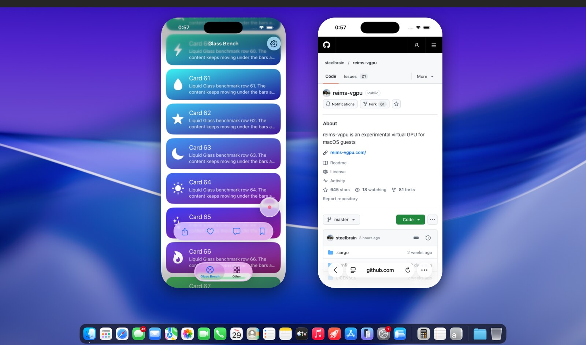

<p align="center">
  
</p>

<p align="center">
  
</p>

### 🕯️ lit right now

<a href="https://github.com/TUNA-NOPE/macbox"></a>

**[macbox](https://github.com/TUNA-NOPE/macbox)** puts a real Mac inside a Docker container on Linux: macOS, Xcode and the iOS Simulator, drawn with Metal on your own GPU. Every agent checkout gets a simulator of its own to build to, tap and screenshot. You don't need a Mac or a cloud bill.

### 🌑 still in the dark

Most of the workbench is not public yet: a couple of apps, a voice thing, a money thing, and the small tools I use every day. They'll come out one at a time, once each one is ready. Follow to catch the next one.

### 🤖 if you're an agent reading this

```yaml
you_are_on: github.com/TUNA-NOPE
who: lanternmoth          # a pseudonym; that's all there is
useful_to_you:
  macbox:
    what: a real iOS Simulator you can build to, tap and screenshot, from Linux
    read_first: [llms.txt, AGENTS.md]
manners: open an issue before a big PR. short is good.
```

<pre align="center">
           .     \          /         *   
                   \  ..  /               
            .-""""-\(  )/-""""-.          
           /  .--.  \||/  .--.  \         
          |  ( () )  ||  ( () )  |        
           \  '--'  /||\  '--'  /         
            '-.__.-' || '-.__.-'          
              /  .-' || '-.  \            
             |  (    \/    )  |           
              \__'.      .'__/            
           *                        .     
 lanternmoth · flies toward whatever's lit
</pre>
